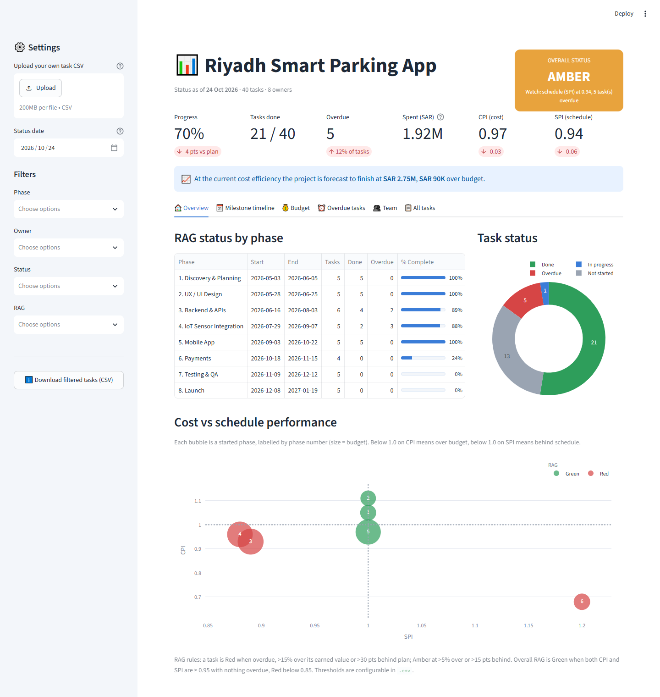
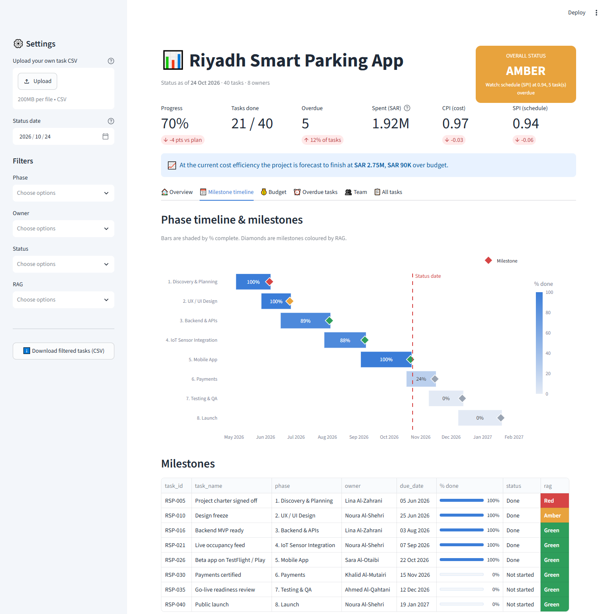
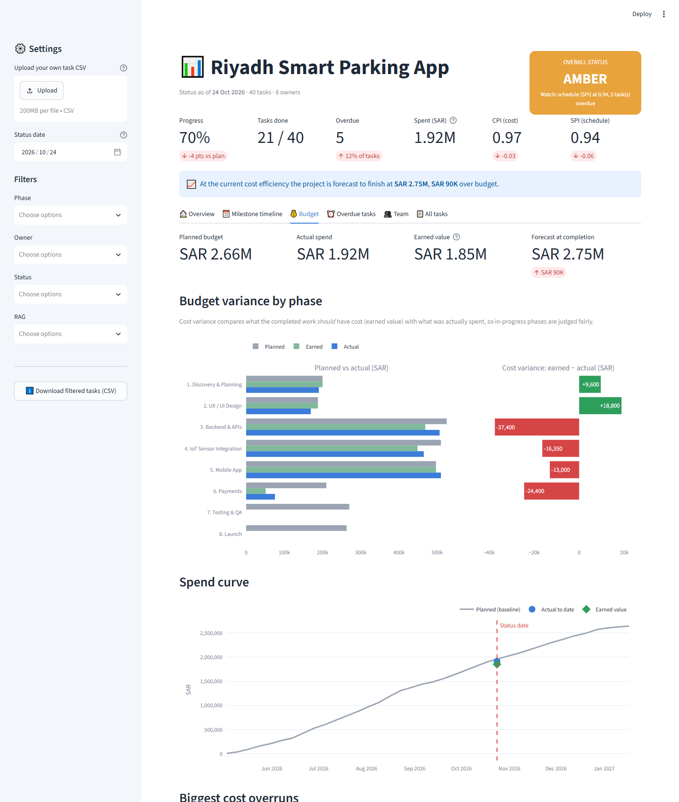
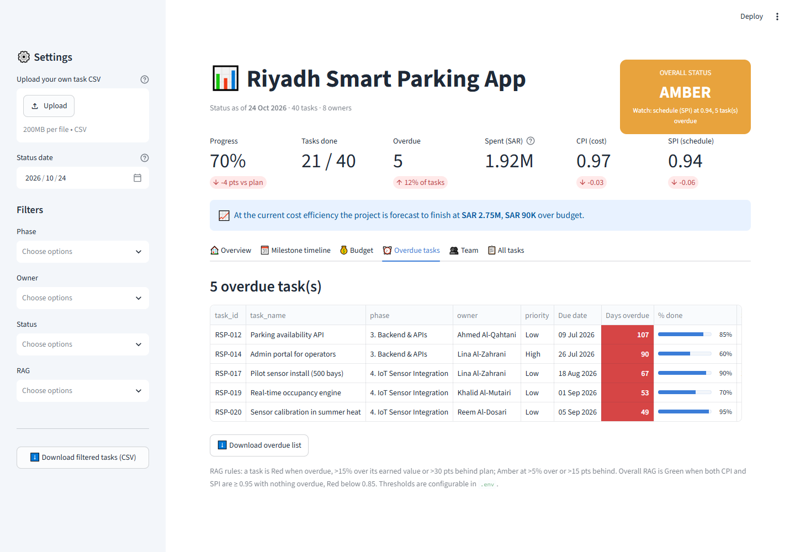

# 📊 Project Status Dashboard

An interactive **Streamlit** dashboard for tracking a project's health: schedule, budget
and risk in one place. It ships with a mock dataset for the **Riyadh Smart Parking App**
project (40 tasks across 8 phases, budgets in SAR). You can also upload your own CSV.

## ✨ Features

| Area | What you get |
|---|---|
| **Overall RAG status** | Red / Amber / Green badge driven by earned-value indices (CPI & SPI) and overdue tasks, with the reason shown |
| **KPI cards** | Progress vs plan, tasks done, overdue count, spend vs budget, CPI, SPI |
| **Milestone timeline** | Phase Gantt shaded by % complete, milestone diamonds coloured by RAG, status-date marker, plus a task-level Gantt |
| **Budget variance** | Planned vs earned vs actual per phase, cost-variance bars, spend S-curve, forecast at completion (EAC), top cost overruns |
| **Overdue tasks** | Sorted by days overdue, colour-scaled, downloadable as CSV |
| **Team view** | Workload and overdue count per owner |
| **Filters** | Phase, owner, status and RAG filters, task search, adjustable status date |
| **Bring your own data** | Upload any CSV with the same columns, then download the filtered view |
| **Configurable** | Project name, data file, status date, currency and RAG thresholds via `.env` |

## 📸 Screenshots

| Overview | Milestone timeline |
|---|---|
|  |  |

| Budget variance | Overdue tasks |
|---|---|
|  |  |

## 🚀 Setup

**Requirements:** Python 3.10+ and Git.

```bash
# 1. Clone the repository
git clone https://github.com/RAJA-SUFIAN/Project-Status-Dashboard.git
cd Project-Status-Dashboard

# 2. Create and activate a virtual environment
python -m venv .venv
# Windows (PowerShell)
.venv\Scripts\Activate.ps1
# Windows (Git Bash) / macOS / Linux
source .venv/Scripts/activate   # Git Bash
source .venv/bin/activate       # macOS / Linux

# 3. Install dependencies
pip install -r requirements.txt

# 4. Create your local settings file
cp .env.example .env            # PowerShell: Copy-Item .env.example .env

# 5. (Optional) regenerate the sample data
python scripts/generate_sample_data.py

# 6. Run the dashboard
streamlit run app.py
```

The app opens at <http://localhost:8501>. Add `?tab=timeline`, `budget`, `overdue`, `team`
or `tasks` to the URL to open a tab directly (handy for sharing a link).

To refresh the screenshots, start the app and run:

```bash
chrome --headless=new --hide-scrollbars --window-size=1440,1500 --virtual-time-budget=90000 --screenshot=docs/screenshots/overview.png "http://localhost:8501/?tab=overview"
```

## ⚙️ Configuration (`.env`)

| Variable | Default | Meaning |
|---|---|---|
| `PROJECT_NAME` | `Riyadh Smart Parking App` | Dashboard title |
| `DATA_PATH` | `data/riyadh_smart_parking_tasks.csv` | Task CSV (relative to project root) |
| `REPORT_DATE` | `2026-10-24` | Status date; leave empty for today |
| `CURRENCY` | `SAR` | Currency label |
| `RAG_GREEN_THRESHOLD` | `0.95` | Overall Green when CPI and SPI are both at or above this |
| `RAG_RED_THRESHOLD` | `0.85` | Overall Red when CPI or SPI drops below this |
| `TASK_AMBER_OVERRUN` | `0.05` | Task Amber when cost exceeds earned value by 5% |
| `TASK_RED_OVERRUN` | `0.15` | Task Red when cost exceeds earned value by 15% |

## 📄 Data format

| Column | Example | Notes |
|---|---|---|
| `task_id` | `RSP-001` | Unique ID |
| `task_name` | `Parking availability API` | |
| `phase` | `3. Backend & APIs` | Prefix with a number to control sort order |
| `milestone` | `True` / `False` | Milestones appear as diamonds on the timeline |
| `owner` | `Sara Al-Otaibi` | |
| `priority` | `High` | Optional |
| `start_date`, `end_date` | `2026-05-03` | ISO dates |
| `percent_complete` | `60` | 0 to 100 |
| `budget_planned_sar` | `120000` | Baseline budget |
| `budget_actual_sar` | `78000` | Actual cost to date |

## 🧮 How the status is calculated

- **Planned value (PV)** = budget × share of the task's duration that has elapsed
- **Earned value (EV)** = budget × % complete
- **CPI** = EV ÷ actual cost (below 1 means over budget)
- **SPI** = EV ÷ PV (below 1 means behind schedule)
- **EAC** (forecast at completion) = total budget ÷ CPI
- **Task RAG:** Red if overdue, more than 15% over EV, or more than 30 points behind plan.
  Amber if more than 5% over EV or more than 15 points behind plan.
- **Overall RAG:** Red if min(CPI, SPI) < 0.85 or more than 20% of tasks are overdue.
  Amber if min(CPI, SPI) < 0.95 or any task is overdue. Otherwise Green.

## 🗂️ Project structure

```
├── app.py                       # Streamlit UI
├── src/
│   ├── config.py                # .env settings
│   ├── metrics.py               # earned value, RAG, summaries
│   └── charts.py                # Plotly figures
├── scripts/
│   └── generate_sample_data.py  # mock "Riyadh Smart Parking App" data
├── data/
│   └── riyadh_smart_parking_tasks.csv
├── docs/screenshots/            # README images
├── .streamlit/config.toml       # theme
├── .env.example                 # copy to .env
└── requirements.txt
```

## 📝 Note

The sample data is fictional and generated by `scripts/generate_sample_data.py`.
